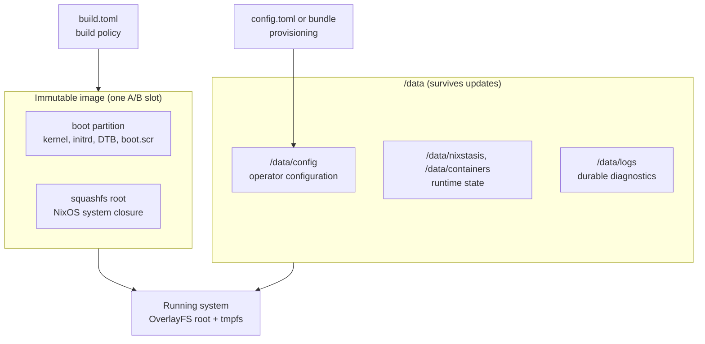

# Architecture

AtomixOS is built so that a remote device can always get back to a working image. Five ideas carry that goal:

- **Paired A/B slots.** Each slot holds a boot partition and a root filesystem that are always written together, so the
  kernel and the root filesystem never get out of step. See [Partition Layout](architecture/partition-layout.md).
- **A read-only root.** The root filesystem is a squashfs image under an OverlayFS with a tmpfs upper layer. Every boot
  starts from the same state, and anything that must survive lives on `/data`.
- **Boot counting and local confirmation.** U-Boot gives a new slot three tries. The device commits the slot only after
  its own health checks pass, without asking a server. See [Update and Rollback](architecture/update-rollback.md).
- **An isolated gateway.** The device serves its LAN but never forwards packets between LAN and WAN. See
  [Network Topology](architecture/network-topology.md).
- **No shared credentials.** Images ship without passwords or keys; each device gets its own on first boot. See
  [Authentication](architecture/authentication.md).

Two inputs shape a device. `build.toml` is fixed when the image is built. `config.toml` is supplied when the device is
provisioned and can change later without a new image. [Runtime Boundaries](runtime-boundaries.md) explains what each one
owns, and [Data Flow](data-flow.md) follows the data through boot, provisioning, and updates. The reasons behind the
main choices are collected in [Design Decisions](design-decisions.md).

## Immutable Build Policy

Build policy and runtime provisioning are kept apart. The committed `build.toml` holds the settings that are fixed into
NixOS systems, disk images, and update bundles, such as watchdog enforcement and the bootstrap transport.
`/data/config/config.toml` holds runtime operator and application state.

Nix validates `build.toml` before it builds anything, then maps the effective values onto NixOS module options. Every
built system exposes the same read-only policy and its provenance at `/etc/atomixos/build.toml` and
`/etc/atomixos/build-metadata.json`, and disk image and RAUC bundle outputs carry the same two files alongside them, so
you can audit any artifact.

`build.toml` does not hold the source revision, `flake.lock`, production verification certificates, or signing
credentials. Those are separate release inputs. The schema and every field are described in
[Build Configuration](reference/build-configuration.md).
