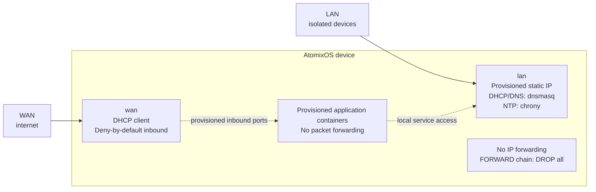

# Network Topology

An AtomixOS device sits between two networks. The WAN side reaches the internet and carries management and any
application traffic you open. The LAN side serves isolated local devices. The device never routes packets between the
two.

## Interface Roles



## WAN Interface (`wan`)

- Always the board's onboard Ethernet: the RK3328 GMAC on ROCK64, GMAC1 on the Radxa CM3 IO board.
- Gets its address, routes, and DNS servers over DHCPv4 through systemd-networkd, unless provisioning sets a static
  configuration.
- Drops new inbound connections unless provisioning opens specific ports.

## LAN Interface (`lan`)

- The first USB Ethernet adapter using the `r8152`, `ax88179_178a`, or `cdc_ether` driver.
- Has a static gateway address: the provisioned one, or `172.20.30.1/24` if none is provisioned.
- Runs `dnsmasq` for DHCP (by default `172.20.30.10` to `172.20.30.254`) and for local DNS names. It answers only for
  local names and never forwards queries upstream.
- Runs `chrony` as the NTP server for the LAN subnet.

How to change the LAN range is covered in [LAN Range](../provisioning/lan-range.md).

## Isolation Model

IP forwarding is turned off in the kernel (`modules/networking.nix`):

```nix
boot.kernel.sysctl = {
  "net.ipv4.ip_forward" = 0;
  "net.ipv6.conf.all.forwarding" = 0;
};
```

The nftables `forward` chain also has a `drop` policy with no exceptions. LAN devices can reach the gateway's own
services (DHCP, DNS, NTP, SSH, and the first-boot console) but get no route to the internet. WAN ports for
applications or a VPN open only when provisioned.

## NIC Naming

Interface names come from systemd `.link` files, not udev rules. Each board module sets the match for its onboard NIC
(`atomixos.network.wanLinkMatch`); the USB match (`atomixos.network.lanLinkMatch`) is shared:

| Link file | Matches                                                                                                  | Resulting name |
|-----------|----------------------------------------------------------------------------------------------------------|----------------|
| `10-wan`  | The onboard NIC: platform path `platform-ff540000.ethernet` (ROCK64), `platform-fe010000.ethernet` (CM3) | `wan`          |
| `20-lan`  | The first adapter using the `r8152`, `ax88179_178a`, or `cdc_ether` driver                               | `lan`          |

`wan` and `lan` are names the kernel never assigns, so the result does not depend on which NIC registers first.
Renaming to a kernel name such as `eth0` fails when another NIC has already taken it, which could leave the onboard WAN
port with the LAN name and its open LAN firewall rule. Further USB adapters keep their kernel names (`eth0`, `eth1`, …)
and can be configured as additional interfaces. QEMU test VMs keep kernel names: `eth0` is WAN and `eth1` is LAN.

Wi-Fi is not supported: AtomixOS configures no wireless interface, and the ROCK64 kernel is built without wireless or
Bluetooth support.

## Firewall Summary

| Interface  | Direction | Allowed                                                                                                 |
|------------|-----------|---------------------------------------------------------------------------------------------------------|
| wan        | Inbound   | Provisioned ports only                                                                                  |
| wan        | Inbound   | TCP 22 (SSH), only while `/data/config/ssh-wan-enabled` exists                                          |
| wan        | Inbound   | TCP 8080 (first-boot console), only before provisioning and only with the `network` bootstrap transport |
| lan        | Inbound   | Everything by default; a provisioned `lan` scope switches to an allowlist                               |
| tun0 (VPN) | Inbound   | TCP 22 (SSH)                                                                                            |
| any        | Forward   | Nothing                                                                                                 |

Provisioned WAN ports, and the optional LAN allowlist, come from `/data/config/firewall-inbound.json`, described in
[Runtime Boundaries](../runtime-boundaries.md#firewall-json). The rules are defined in `modules/firewall.nix`; see the
[Firewall module](../code-reference/modules.md#firewallnix).
