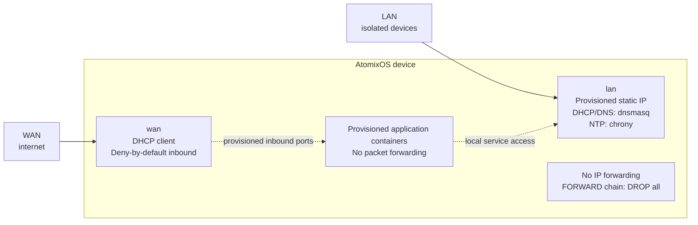

# Network Topology

Each AtomixOS device can use two Ethernet interfaces to keep LAN-side services isolated from WAN-side management and
application ingress.

## Interface Roles



## WAN Interface (wan)

- Mapped to the onboard RK3328 GMAC via systemd `.link` file (platform path `platform-ff540000.ethernet`)
- DHCP v4 client via systemd-networkd
- Uses DHCP-provided DNS servers
- Firewall drops new inbound traffic by default
- Provisioned firewall state may open application or VPN ports from `/data/config/firewall-inbound.json`

## LAN Interface (lan)

- USB Ethernet adapter (any supported chipset: r8152, ax88179, cdc_ether)
- Static IP: provisioned LAN gateway, falling back to `172.20.30.1/24`
- Runs dnsmasq DHCP server from the provisioned range, with fallback `172.20.30.10` -- `172.20.30.254`
- Runs chrony NTP server for the provisioned LAN subnet, with fallback `172.20.30.0/24`
- Runs gateway-local DNS only: dnsmasq serves local names on `53` and does not forward upstream

## Isolation Model

IP forwarding is explicitly disabled at the kernel level:

```nix
boot.kernel.sysctl = {
  "net.ipv4.ip_forward" = 0;
  "net.ipv6.conf.all.forwarding" = 0;
};
```

The nftables `FORWARD` chain has a `drop` policy with no exceptions. LAN devices get DHCP, DNS, NTP, SSH, and first-boot
bootstrap access on lan, but no packet-level internet routing. WAN application or VPN exposure is created only from
provisioned firewall state.

## NIC Naming

Deterministic interface naming uses systemd `.link` files rather than udev rules:

| Link File | Match                                                                                                             | Name        |
|-----------|-------------------------------------------------------------------------------------------------------------------|-------------|
| `10-wan`  | The board's onboard NIC (`atomixos.network.wanLinkMatch`), e.g. ROCK64 platform path `platform-ff540000.ethernet` | `wan`       |
| `20-lan`  | USB Ethernet drivers `r8152`, `ax88179_178a`, `cdc_ether` (`atomixos.network.lanLinkMatch`)                       | `lan`       |
| WiFi      | Unsupported until hardware selection                                                                              | kernel name |

`wan` and `lan` are names the kernel never assigns, so the result does not depend on which NIC registers first. A
rename to a kernel name such as `eth0` fails when another NIC already took it, which could leave the onboard WAN port
with the LAN name. The first USB adapter becomes `lan`; further adapters keep their kernel names (`eth0`, `eth1`, ...)
and can be configured as additional interfaces. QEMU test VMs keep kernel names (`eth0` WAN, `eth1` LAN).

## Firewall Summary

| Interface  | Direction | Allowed Ports                                                            |
|------------|-----------|--------------------------------------------------------------------------|
| wan (WAN)  | Inbound   | provisioned firewall ports only                                          |
| wan (WAN)  | Inbound   | TCP 22 (SSH) -- only with flag file                                      |
| lan (LAN)  | Inbound   | open by default; explicit `lan` scope switches to allowlisted ports only |
| tun0 (VPN) | Inbound   | TCP 22 (SSH)                                                             |
| any        | Forward   | DROP (no exceptions)                                                     |

Provisioned WAN and optional restrictive LAN ports come from `/data/config/firewall-inbound.json`. SSH on WAN is
controlled by the presence of `/data/config/ssh-wan-enabled`. See the [Firewall module](../code-reference/modules.md#firewallnix) for
implementation details.
