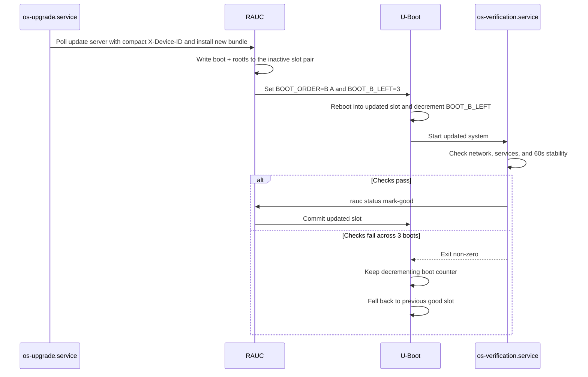

# Update & Rollback Flow

AtomixOS uses RAUC for A/B slot management combined with U-Boot boot-count logic and watchdog integration for automatic
recovery from failed updates.

## Normal Update Cycle

## Boot-Count Mechanism

U-Boot maintains three environment variables for slot selection:

| Variable      | Purpose                            | Example |
|---------------|------------------------------------|---------|
| `BOOT_ORDER`  | Slot priority (first = preferred)  | `"A B"` |
| `BOOT_A_LEFT` | Remaining boot attempts for slot A | `3`     |
| `BOOT_B_LEFT` | Remaining boot attempts for slot B | `3`     |

On each boot, U-Boot RAUC bootmeth selects the slot and decrements the boot attempt counter before loading
`boot.scr`. The script:

1. Reads the bootmeth-provided boot partition and root partition variables
2. Sets `rauc.slot` and `atomixos.lowerdev` for the selected slot
3. Loads kernel, initrd, and DTB from that slot's boot partition
4. Boots with `root=fstab` so initrd mounts the selected squashfs by lower device

If a slot's counter reaches 0, RAUC bootmeth skips it and tries the next slot in `BOOT_ORDER`. This ensures automatic
rollback after 3 consecutive boot failures.

`/boot` is boot slot A's partition, which RAUC overwrites while slot B runs, and RAUC refuses to install to a mounted
slot. It is therefore an automount: it mounts when accessed (first boot reads the fresh-flash `/boot/config.toml` seed)
and unmounts after a minute idle, so it is not mounted during later updates.

## Health Check Details

The `os-verification.service` performs these checks before committing a slot:

1. **Service checks**: dnsmasq and chronyd must be active
2. **Network checks**: eth0 must exist with networkd configuration that has not failed (a missing WAN address only
   warns, so an outage does not roll back a working image); eth1 must have the expected LAN gateway IP
3. **Sustained check**: all above conditions must hold for 60 seconds (checked every 5 seconds) to catch restart loops

Only after all checks pass does the service run `rauc status mark-good`, which resets the boot counter and commits the
slot. It does this on every healthy boot, not only the first after an update, because U-Boot uses one boot try on every
boot.

## First Boot Exception

On initial device provisioning, `first-boot.service` writes the sentinel file
(`/data/.completed_first_boot`) after successful provisioning import/validation and marks the slot good only when RAUC
is enabled. After this, all subsequent boots use the full health-check path.

## Watchdog Integration

Hardware watchdog enforcement is opt-in through the immutable `build.toml` policy field
`watchdog.enable_hardware`. When enabled, `watchdog.backend = "internal"` selects the RK3328 DesignWare device
`/dev/watchdog-internal`; `watchdog.backend = "external"` selects the TI UCC2946 path
`/dev/watchdog-external` through the I2C expander at bus 1/address `0x41`. Systemd remains the sole owner of either
path and uses these default manager settings:

- **Runtime watchdog**: 30 seconds -- if systemd hangs, the device reboots
- **Reboot watchdog**: 10 minutes -- if a reboot hangs, the watchdog forces a hard reset

Enforcement remains disabled by default on Rock64, VM, and development images; enabling it in a release profile
requires physical reset-timing, RAUC rollback, and soak validation. If an
enabled system has no usable watchdog device, `watchdog-device-check.service` warns and exits successfully: boot and
update verification continue, and the condition does not itself mutate RAUC state.

The boot-count helper package and service are present only when RAUC is enabled; non-RAUC profiles do not carry this
update rollback integration. The intended hardware rollback behavior applies to a newly updated, still-unconfirmed slot.
Repeated watchdog resets before `os-verification` can mark that slot good consume its U-Boot attempts until U-Boot
returns to the previous slot. An already confirmed slot is outside this rollback claim.

## Update Polling

The `os-upgrade.service` runs on a systemd timer:

- First check: 5 minutes after boot
- Subsequent checks: every 1 hour (configurable)
- Random delay: up to 10 minutes (prevents thundering herd across fleet)

The service sends `GET <server_url>/api/v1/updates/latest` with these headers:

| Header              | Value                                                         |
|---------------------|---------------------------------------------------------------|
| `X-Device-ID`       | Compact lowercase 12-hex eth0 MAC, for example `aabbccddeeff` |
| `X-Current-Version` | Booted bundle version from `rauc status`                      |
| `X-Compatible`      | Board's RAUC compatible: `rock64` or `radxa-cm3-io`           |

The server answers with a JSON object containing `version`, `bundle_url` (HTTPS), and optionally `compatible`. It must
choose a bundle built for the device's `X-Compatible`. Devices running images from before the header existed send none;
all of them are ROCK64, so the server must treat a missing `X-Compatible` as `rock64`. If the response names a different
`compatible`, the device skips the update without downloading it; a response without `compatible` is still accepted, and
`rauc install` rejects a bundle for another board. If a newer matching bundle is available, the service downloads it to
`/data`, installs it via `rauc install`, and reboots. The hawkBit path is reserved for future implementation and is not
an operational update mode in the current image.
