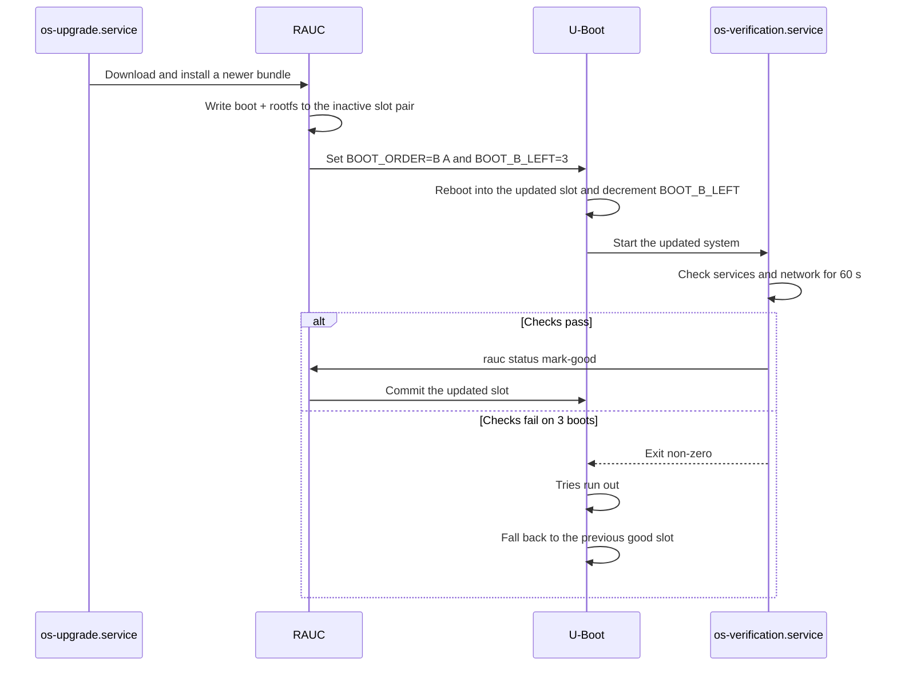

# Update and Rollback

A new image has to prove itself before the device keeps it. RAUC writes the update to the inactive slot, U-Boot gives
that slot a fixed number of tries, and `os-verification.service` commits it only after the device stays healthy. If
the slot never proves itself, U-Boot goes back to the previous one.

## Normal Update Cycle

## Boot-Count Mechanism

U-Boot keeps three variables in its environment, which is in SPI flash on ROCK64 and on the eMMC on the CM3:

| Variable      | Purpose                            | Example |
|---------------|------------------------------------|---------|
| `BOOT_ORDER`  | Slot priority, first is preferred  | `"A B"` |
| `BOOT_A_LEFT` | Remaining boot attempts for slot A | `3`     |
| `BOOT_B_LEFT` | Remaining boot attempts for slot B | `3`     |

On every boot, U-Boot's RAUC boot method picks the first slot in `BOOT_ORDER` that still has tries left, decrements its
counter, and runs `boot.scr`. The script:

1. Reads the boot and root partitions chosen by the boot method.
2. Sets `rauc.slot` and `atomixos.lowerdev` for that slot.
3. Loads the kernel, initrd, and DTB from the slot's boot partition.
4. Boots with the NixOS kernel parameters (`boot.kernelParams`, such as `lsm=bpf`), the board's console arguments, and
   `root=fstab`, so the initrd mounts the selected squashfs as the lower layer.

If the selected slot fails to load or boot, the U-Boot boot command ends with `reset`, so the board restarts with the
counter already decremented instead of stopping at the U-Boot prompt. A slot whose counter reaches 0 is skipped, so
three failed boots in a row move the device back to the other slot.

A kernel panic counts as a failed boot without anyone power-cycling the device: `kernel.panic` is 10, so the kernel
reboots itself 10 seconds after a panic. This sysctl is applied by `systemd-sysctl` in the running system, so a panic
earlier in boot, including in the initrd, still hangs until the hardware watchdog or a power cycle resets the board.

### Bootloader updates

RAUC bundles update the boot and root slots, including `boot.scr`, but never U-Boot itself. U-Boot changes, such as the
`; reset` boot command or the `START_UMS` `PREBOOT`, reach a device only when it is flashed with a new image. So
`boot.cmd` must keep working with the U-Boot already on deployed devices:

- New U-Boot features are additive. `boot.cmd` does not rely on them, and keeps any behavior that older U-Boot builds
  provide only through the script, such as the `START_UMS` handler.
- `boot.cmd` resets the board itself when a boot file fails to load or `booti` fails, so a ROCK64 whose boot command
  lacks `; reset` still falls back after a bad kernel, DTB, or initrd. Only an unreadable `boot.scr` on such a device
  stops at the U-Boot prompt.

The boot command and `PREBOOT` are U-Boot's default `bootcmd` and `preboot` variables, and the RAUC boot method saves
the whole environment on every boot. A saved environment keeps the `bootcmd` and `preboot` of the U-Boot that first
saved it, so a newer U-Boot's defaults apply only once that environment is reset:

- **CM3:** flashing a new image clears the eMMC environment.
- **ROCK64:** the environment is in SPI flash, which flashing the eMMC never touches. After flashing a newer U-Boot, run
  `env default bootcmd preboot; saveenv` at the U-Boot prompt to adopt its defaults.

`/boot` is slot A's boot partition, which RAUC overwrites while slot B runs, and RAUC refuses to install to a mounted
slot. So `/boot` is an automount: it mounts when accessed (first boot reads the fresh-flash `/boot/config.toml` seed)
and unmounts after a minute idle, so it is not mounted during later updates.

## Health Check Details

`os-verification.service` (`scripts/os-verification.sh`) runs on every boot and checks:

1. **Services:** `dnsmasq` and `chronyd` are active, and `lan-gateway-apply.service` and
   `provisioned-firewall-inbound.service` completed without failing.
2. **WAN:** the `wan` interface exists and its networkd configuration has not failed. A missing WAN address only
   warns, so an upstream outage does not roll back a working image.
3. **LAN:** the `lan` interface has the provisioned LAN gateway address.
4. **Required units:** every unit listed in `/data/config/health-required.json` is active.
5. **Stability:** all of the above keep passing for 60 seconds, checked every 5 seconds, which catches restart loops.

When everything passes, the service runs `rauc status mark-good`, which resets the slot's counter and commits it. It
does this on every healthy boot, not only after an update, because U-Boot spends a try on every boot.

## First Boot Exception

On a device's first boot, `first-boot.service` imports and validates the configuration, writes the sentinel
`/data/.completed_first_boot`, and marks the slot good when RAUC is enabled. Every later boot uses the full health
check.

## Watchdog Integration

Hardware watchdog enforcement is off by default and is turned on in `build.toml`, which also picks the watchdog device
and timeouts; see [Watchdog Backend Selection](../reference/build-configuration.md#watchdog-backend-selection).

systemd is the only process that drives the watchdog. Its runtime timeout resets the board if systemd hangs, and its
reboot timeout resets the board if a reboot hangs.

If enforcement is on but no usable device exists, `watchdog-device-check.service` logs a warning and exits successfully.
Boot and update verification carry on, and RAUC state is not changed.

Watchdog resets feed the same boot counter as any other failed boot. U-Boot spends a try on every boot, and
`os-verification` restores the counter only after a healthy boot, so any slot that resets three boots in a row, whether
newly updated or previously confirmed, uses up its tries and U-Boot falls back to the other slot.

## Update Polling

`os-upgrade.service` runs from a systemd timer: first 5 minutes after boot, then every hour by default
(`os-upgrade.pollingInterval`), with up to 10 minutes of random delay so a fleet does not poll in step.

It reads its server from `/data/config/os-upgrade.json` and does nothing when no server is provisioned. Otherwise it
sends `GET <server_url>/api/v1/updates/latest` with these headers:

| Header              | Value                                                                                            |
|---------------------|--------------------------------------------------------------------------------------------------|
| `X-Device-ID`       | The [device ID](authentication.md#device-identity), or `unknown` when the WAN MAC cannot be read |
| `X-Current-Version` | The booted bundle version from `rauc status`                                                     |
| `X-Compatible`      | The board's RAUC compatible: `rock64` or `radxa-cm3-io`                                          |

The server answers with a JSON object containing `version`, `bundle_url` (HTTPS), and optionally `compatible`. It must
choose a bundle built for the device's `X-Compatible`. Devices running images from before the header existed send none;
all of them are ROCK64, so the server must treat a missing `X-Compatible` as `rock64`. If the response names a different
`compatible`, the device skips the update without downloading it. A response without `compatible` is still accepted, and
`rauc install` rejects a bundle built for another board. If a newer matching bundle is available, the service downloads
it to `/data`, installs it with `rauc install`, and reboots.

hawkBit is not a working update path. Setting `os-upgrade.useHawkbit` turns polling off and installs
`rauc-hawkbit-updater`, but AtomixOS configures no hawkBit server, credentials, or service for it.
