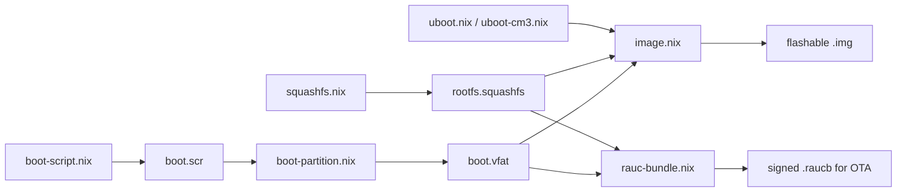

# Nix Derivations

The derivations in `nix/` produce the build artifacts. `mkBoardPackages` in `flake.nix` calls each one with
`pkgs.callPackage` once per entry in its `boards` table (`rock64`, `cm3`) and exposes the results as attributes of the
board package (`.#rock64.image`, `.#cm3.rauc-bundle`, and so on); see [Flake Outputs](../reference/flake-outputs.md).
The build templates they delegate to are described in [Scripts](scripts.md#build-scripts).

Every derivation that takes `nixosConfig` also takes `board`, which defaults to `nixosConfig.atomixos.board` and
prefixes the derivation and artifact names.

## Build Pipeline



`image.nix` and `rauc-bundle.nix` also take the effective build configuration. They add `-dev` to the artifact name
when a local override is applied, and install `build.toml` and `build-metadata.json` (mode `0444`) next to the
artifact.

## squashfs.nix

Builds a read-only squashfs image from the full NixOS system closure.

```nix
{ stdenv, squashfsTools, closureInfo, nixosConfig, maxSquashfsSize, board }:
```

| Parameter         | Source                       | Description                                                 |
|-------------------|------------------------------|-------------------------------------------------------------|
| `nixosConfig`     | `boards.<board>.nixosConfig` | The board's evaluated NixOS configuration                   |
| `maxSquashfsSize` | `flake.nix`                  | Rootfs slot size from `nix/partition-layout.nix` (1024 MiB) |

Delegates to `scripts/build-squashfs.sh`:

1. Collect every store path in the `closureInfo` of `system.build.toplevel`.
2. Copy them into a pseudo-root directory.
3. Create `/init` and `/sbin/init` symlinks to the NixOS init.
4. Create empty mount-point directories (`/proc`, `/sys`, `/dev`, `/run`, `/etc`, `/var`, `/tmp`, and others).
5. Run `mksquashfs` with `-comp zstd -Xcompression-level 19 -b 1048576 -no-xattrs -all-root`.
6. Fail if the image is larger than `maxSquashfsSize`.

Output: `$out/rootfs.squashfs`.

## boot-partition.nix

Builds the vfat boot-slot filesystem once for both factory images and RAUC bundles.

```nix
{ stdenvNoCC, dosfstools, mtools, nixosConfig, bootScript, partitionLayout, board }:
```

The filesystem is `partitionLayout.boot.sizeMiB` (128 MiB), labeled `BOOT`, and contains:

| Path                              | Source                                             |
|-----------------------------------|----------------------------------------------------|
| `Image`                           | Kernel                                             |
| `initrd`                          | NixOS initial ramdisk                              |
| `dtbs/<hardware.deviceTree.name>` | The board's device tree, with its overlays applied |
| `boot.scr`                        | `boot-script` package                              |

Before creating the filesystem it totals the payload and fails with a per-file size breakdown if the files plus a 4 MiB
FAT reserve exceed the slot, instead of failing later with mtools' "Disk full". The build log reports the space left.

Output: `$out/boot.vfat`.

## rauc-bundle.nix

Builds a signed RAUC bundle that holds the boot and rootfs images for one slot pair.

```nix
{ stdenv, rauc, squashfsTools, buildConfiguration, nixosConfig,
  squashfsImage, bootPartition, signingCert, signingKeyPath, board }:
```

| Parameter            | Source                            | Description                        |
|----------------------|-----------------------------------|------------------------------------|
| `buildConfiguration` | `lib.effectiveBuildConfiguration` | Artifact suffix and audit sidecars |
| `nixosConfig`        | `boards.<board>.nixosConfig`      | RAUC compatible and bundle version |
| `squashfsImage`      | `.#<board>.squashfs`              | Squashfs derivation output         |
| `bootPartition`      | `.#<board>.boot-partition`        | Shared boot-slot filesystem        |
| `signingCert`        | `./certs/dev.signing.cert.pem`    | RAUC signing certificate           |
| `signingKeyPath`     | `./certs/dev.signing.key.pem`     | RAUC signing private key           |

Delegates to `scripts/build-rauc-bundle.sh`:

1. Copy the shared `boot.vfat` into the bundle directory.
2. Copy `rootfs.squashfs` into the bundle directory.
3. Write `manifest.raucm` with the board's `atomixos.rauc.compatible` (`rock64` or `radxa-cm3-io`).
4. Sign and package with `rauc bundle`.

Output: `$out/<board>.raucb` (for example `rock64.raucb` or `cm3.raucb`; `<board>-dev.raucb` with a local override),
plus `build.toml` and `build-metadata.json`.

```ini
[update]
compatible=<nixosConfig.atomixos.rauc.compatible>
version=<nixosConfig.system.nixos.version>

[image.boot]
filename=boot.vfat
type=raw

[image.rootfs]
filename=rootfs.squashfs
type=raw
```

The development keys are committed for development and testing only. A production bundle overrides `signingCert` and
`signingKeyPath` with production credentials.

## boot-script.nix

Compiles the U-Boot boot script from `scripts/boot.cmd`.

```nix
{ stdenv, ubootTools, nixosConfig, buildId, board, systemClosure, dtbPath,
  rootfsPathA, rootfsPathB, kernelParams, bootargsBase, recoveryButtonPin, ramdiskAddr }:
```

| Parameter                   | Source                                  | Description                                                              |
|-----------------------------|-----------------------------------------|--------------------------------------------------------------------------|
| `buildId`                   | `flake.nix`                             | First 32 characters of the squashfs store path name, echoed              |
| `systemClosure`             | `system.build.toplevel`                 | Kernel `init=` target                                                    |
| `dtbPath`                   | `hardware.deviceTree.name`              | DTB loaded from the boot slot                                            |
| `rootfsPathA`/`rootfsPathB` | `atomixos.rauc.slots.rootfs0`/`rootfs1` | Kernel `atomixos.lowerdev` per slot                                      |
| `kernelParams`              | `boot.kernelParams` minus `root=fstab`  | NixOS parameters, placed before `bootargsBase`                           |
| `bootargsBase`              | `boards.<board>.bootScript`             | Console, earlycon, and log level                                         |
| `recoveryButtonPin`         | `boards.<board>.bootScript`             | UMS hold-button GPIO (`100` on Rock64); empty disables it                |
| `ramdiskAddr`               | `boards.<board>.bootScript`             | `ramdisk_addr_r` override (`0x08000000` on Rock64); empty keeps U-Boot's |

The values derived from `nixosConfig` are defaults; `flake.nix` passes only `nixosConfig`, `buildId`, and the board
table values.

```sh
mkimage -C none -A arm64 -T script -d boot.cmd boot.scr
```

Output: `$out/boot.scr` and a copy of the substituted `$out/boot.cmd`.

## image.nix

Assembles the flashable eMMC disk image.

```nix
{ stdenv, util-linux, uboot, buildConfiguration, board, nixosConfig,
  squashfsImage, bootPartition, partitionLayout }:
```

| Parameter            | Source                            | Description                               |
|----------------------|-----------------------------------|-------------------------------------------|
| `uboot`              | `.#<board>.uboot`                 | Board U-Boot (`idbloader` + `u-boot.itb`) |
| `buildConfiguration` | `lib.effectiveBuildConfiguration` | Artifact suffix and audit sidecars        |
| `nixosConfig`        | `boards.<board>.nixosConfig`      | Provides the NixOS release series         |
| `squashfsImage`      | `.#<board>.squashfs`              | Squashfs derivation output                |
| `bootPartition`      | `.#<board>.boot-partition`        | Shared boot-slot filesystem               |
| `partitionLayout`    | `nix/partition-layout.nix`        | Shared labels, GUIDs, offsets, and sizes  |

Delegates to `scripts/build-image.sh`. The image is 1170 MiB (U-Boot region, `boot-a`, `rootfs-a`, and 2 MiB of GPT
tail slack); the partition offsets and sizes are listed in
[Partition Layout](../specs/partition-layout.md#emmc-ab-layout). Initrd `systemd-repart` creates `boot-b`, `rootfs-b`,
and `/data` on first boot.

Output: `$out/atomixos-<board>-<series>.img`, named from the board and the pinned NixOS release series (for example
`atomixos-cm3-26.05.img`, or `atomixos-cm3-26.05-dev.img` with a local override), plus `build.toml` and
`build-metadata.json`.

## uboot.nix

Rock64 U-Boot, built from the nixpkgs `ubootRock64` package with these changes:

- The environment lives on SPI flash (`CONFIG_ENV_IS_IN_SPI_FLASH`, offset `0x140000`, size `0x2000`, sector
  `0x1000`) instead of eMMC.
- The RAUC bootmeth selects slots: partitions `1,2` and `3,4`, default order `A B`, 3 tries per slot, and all tries
  reset when every slot reaches zero.
- `bootcmd` is `bootflow scan; reset`, so a slot that fails to boot resets and the decremented try counter falls back
  to the other slot instead of stopping at the prompt.
- USB mass storage over the OTG port (`ums`) is enabled for button-triggered eMMC recovery, and the OTG controller is
  patched to peripheral mode.
- EFI boot is disabled.

## uboot-cm3.nix

Radxa CM3 U-Boot, built from the nixpkgs `ubootRock3C` package with the `radxa-cm3-io-rk3566_defconfig` defconfig:

- The environment lives in the eMMC boot gap with a redundant copy (`CONFIG_ENV_OFFSET=0x3F8000`,
  `CONFIG_ENV_OFFSET_REDUND=0x3F0000`, size `0x8000`), matching `fw_env.config` in `hardware-cm3.nix`. The SPI NOR is
  optional on the CM3, so it is not used.
- The RAUC bootmeth selects slots, and `boot_targets` scans only `mmc0` (the eMMC), so the SD slot never boots first.
- `bootcmd` resets when the selected slot fails to load or boot, so the decremented try counter falls back to the other
  slot instead of stopping at the prompt.
- Installs `idbloader.img` and `u-boot.itb`.

Both boards add `nix/uboot-start-ums.nix`, a `PREBOOT` that runs before slot selection: when `START_UMS=1` (set from
Linux by `boot_to_ums`), it clears the flag, saves the environment, and exposes the eMMC as USB mass storage. Recovery
therefore still works when the selected slot's `boot.scr` is unreadable.
