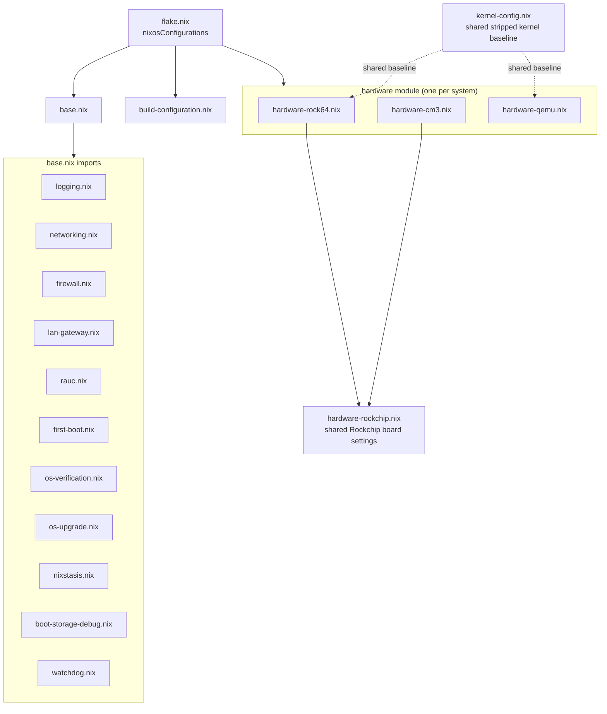

# NixOS Modules

All NixOS modules live in `modules/`. `flake.nix` builds each system from `modules/base.nix`,
`modules/build-configuration.nix`, and one hardware module (`hardware-rock64.nix`, `hardware-cm3.nix`, or
`hardware-qemu.nix`). `base.nix` imports every service module. The two Rockchip board modules also import
`hardware-rockchip.nix` for the settings they share.

## Module Dependency Graph



## base.nix

Shared NixOS configuration for every target: filesystem layout, users, core services, and system packages.

| Setting                | Value       | Notes                                  |
|------------------------|-------------|----------------------------------------|
| `system.stateVersion`  | `"25.11"`   | NixOS state version                    |
| `networking.hostName`  | `"gateway"` |                                        |
| `nix.enable`           | `false`     | No Nix daemon on the read-only root    |
| `documentation.enable` | `false`     | Saves closure space                    |
| `security.sudo.enable` | `false`     | Privilege escalation uses `run0`       |
| `kernel.panic` sysctl  | `10`        | Reboot 10 seconds after a kernel panic |
| `time.timeZone`        | `"UTC"`     |                                        |

### OverlayFS root

The root filesystem is one OverlayFS assembled in the initrd from the selected squashfs slot and tmpfs-backed
upper and work directories:

| Layer              | Mount                 | Filesystem | Description                                               |
|--------------------|-----------------------|------------|-----------------------------------------------------------|
| overlay (combined) | `/`                   | overlay    | Unified writable root presented to userspace              |
| lower (read-only)  | `/run/rootfs-base`    | squashfs   | Immutable NixOS system from the selected RAUC rootfs slot |
| upper (writable)   | `/run/overlay-root/*` | tmpfs      | Ephemeral writes, lost on reboot                          |
| persistent state   | `/data`               | f2fs       | `PARTLABEL=data`, `nofail`, `noatime`                     |

Assembly order before `switch_root`:

1. `boot.scr` passes `root=fstab` and `atomixos.lowerdev=/dev/...` for the selected squashfs slot.
2. `initrd-prepare-overlay-lower.service` waits up to 90 seconds for that block device (eMMC can probe after
   `initrd-root-device.target`), then mounts it read-only at `/run/rootfs-base`.
3. `sysroot.mount` mounts `/` as overlay with `lowerdir=/run/rootfs-base`, `upperdir=/run/overlay-root/upper`, and
   `workdir=/run/overlay-root/work`.
4. `sysroot-run.mount` bind-mounts `/run` into the switched root.

The flashable image has no `/data` partition. Initrd `systemd-repart` creates it from the remaining eMMC space on
first boot.

### Services and files

- `nscd` (nsncd), `chronyd`, and `dnsmasq` run with mount-namespace sandboxing disabled, because those namespaces fail
  on an OverlayFS root; `nscd` runs as root.
- `systemd-remount-fs` is replaced with a no-op, and `sys-fs-fuse-connections.mount` is suppressed.
- `/etc/issue` shows `AtomixOS (<codename>) — build <short git revision>`.
- `tmpfiles.d` creates the `/var` state directories that services expect, including `/var/lib/chrony`,
  `/var/lib/dnsmasq`, `/var/cache/nscd`, `/var/log/journal`, the `appsvc` Quadlet directories under `/var/lib/appsvc`,
  and the persistent rootless image store `/data/containers/rootless/appsvc`.
- System packages: `nano`, `htop`, `curl`, `jq`, `python3`, `f2fs-tools`, `kmod`.

### Users

| User     | Authentication                                                         |
|----------|------------------------------------------------------------------------|
| `root`   | Locked; serial-root recovery on Rockchip boards only when `_RUT_OH_=1` |
| `appsvc` | System account for rootless application containers                     |

Operator users come from provisioning config under `[users]`. Admin users join `wheel`, take SSH keys from
`/data/config/ssh-authorized-keys/<user>`, and keep password authentication locked.

## build-configuration.nix

Applies the validated effective build policy (see [Build Configuration](../reference/build-configuration.md)):

- defines `atomixos.provisioning.bootstrapTransport` (`network` or `nixstasis`, default `network`);
- sets `atomixos.watchdog.*` and `atomixos.nixstasis.*` from the policy;
- installs the canonical policy at `/etc/atomixos/build.toml` and provenance at `/etc/atomixos/build-metadata.json`,
  both mode `0444`.

## logging.nix

Runtime logging: volatile `journald` as ingress, buffered `rsyslog` appends to `/data/logs`, and a shutdown flush.

| Setting           | Value                                                                 |
|-------------------|-----------------------------------------------------------------------|
| journald storage  | `Storage=volatile`                                                    |
| journald cap      | `RuntimeMaxUse=32M`                                                   |
| rsyslog output    | Buffered `omfile` appends to `/data/logs/messages.log` and `auth.log` |
| Podman log driver | `journald`                                                            |

| Service                          | Purpose                                                   |
|----------------------------------|-----------------------------------------------------------|
| `syslog.service`                 | Runs `rsyslogd` after `/data` is mounted                  |
| `logging-shutdown-flush.service` | Flushes journald and asks rsyslog to sync buffered output |

Services and scripts write to stdout and stderr; systemd routes that output through journald into `/data/logs`.

## kernel-config.nix

Shared stripped ARM64 kernel baseline, imported by `hardware-rock64.nix`, `hardware-cm3.nix`, and `hardware-qemu.nix` so
the board kernels and the VM kernel stay close. Each board builds `linux_latest` without the nixpkgs common config and
layers these fragments, then its own options:

- `baseKernelConfig`: the common baseline.
- `optionalKernelConfig`: USB serial support (`USB_SERIAL_FTDI_SIO`, `USB_SERIAL_CP210X` as modules).
- `rockchipKernelConfig`: the Rockchip board layer. It limits SoC support to `ARCH_ROCKCHIP`, disables PCI, unused
  filesystems, and the audio drivers neither board uses, and builds the USB Ethernet drivers as modules: `USB_USBNET`,
  `USB_RTL8152`, `USB_NET_AX88179_178A`, `USB_NET_CDCETHER`.

| Category     | Options                                                    | Build                    |
|--------------|------------------------------------------------------------|--------------------------|
| eMMC         | `MMC_DW`, `MMC_DW_ROCKCHIP`                                | built-in                 |
| Ethernet     | `STMMAC_ETH`, `DWMAC_ROCKCHIP`                             | built-in                 |
| USB host     | `USB_DWC2`, `USB_XHCI_HCD`, `USB_EHCI_HCD`, `USB_OHCI_HCD` | built-in                 |
| Watchdog     | `DW_WATCHDOG`                                              | built-in                 |
| Filesystems  | `SQUASHFS`, `SQUASHFS_ZSTD`, `F2FS_FS`, `OVERLAY_FS`       | built-in                 |
| SPI flash    | `SPI`, `SPI_ROCKCHIP`, `MTD`                               | built-in (U-Boot env)    |
| Wi-Fi and BT | `WLAN`, `CFG80211`, `MAC80211`, `RFKILL`, `BT`             | disabled                 |
| USB network  | `USB_NET_DRIVERS`, `USB_USBNET`                            | disabled in the baseline |

QEMU uses only `baseKernelConfig` and `optionalKernelConfig`.

## hardware-rock64.nix

Rock64 (RK3328) kernel options, device tree, U-Boot environment access, and RAUC slot mapping.

- Stripped kernel from `kernel-config.nix`, plus the on-board RK3328 audio drivers (`SND_SOC_RK3328`,
  `SND_SOC_ROCKCHIP_I2S`, `SND_SOC_ROCKCHIP_SPDIF`).
- Device tree `rockchip/rk3328-rock64.dtb` with the `rock64-internal-watchdog` overlay (`dts/rock64-internal-watchdog.dts`).
  The `rock64-i2c-header` overlay (`dts/rock64-i2c-header.dts`) is added only when hardware watchdog enforcement is
  enabled with the `external` backend.
- `/etc/fw_env.config` points the U-Boot environment tools at SPI flash: `/dev/mtd0 0x140000 0x2000 0x1000`.
- The WAN NIC is matched by `atomixos.network.wanLinkMatch.Path = "platform-ff540000.ethernet"`.
- RAUC is enabled (compatible `rock64`) with these slots:

```nix
atomixos.rauc = {
  enable = lib.mkDefault true;
  slots = {
    boot0 = "/dev/mmcblk1p1";     # boot-a
    boot1 = "/dev/mmcblk1p3";     # boot-b
    rootfs0 = "/dev/mmcblk1p2";   # rootfs-a
    rootfs1 = "/dev/mmcblk1p4";   # rootfs-b
  };
};
```

## hardware-cm3.nix

Radxa CM3 (RK3566) on the CM3 IO Board. See [Radxa CM3](../cm3.md).

- Stripped kernel from `kernel-config.nix`, plus built-in RK3566 drivers: the eMMC host (`MMC_SDHCI_OF_DWCMSHC`), I/O and
  power domains, the TCS4525 CPU regulator (`REGULATOR_FAN53555`), and SCMI clocks and cpufreq. It has no audio: the
  CM3 IO device tree defines no RK809 codec card, and its HDMI sound card needs display drivers the kernel leaves out.
- The `rockchip/rk3566-radxa-cm3-io.dtb` device tree.
- Fixed `/dev/mmcblk0pN` eMMC paths for `/boot`, `/data`, systemd-repart, and the RAUC slots; RAUC compatible
  `radxa-cm3-io`.
- `/etc/fw_env.config` points at the two redundant U-Boot environment copies in the eMMC boot gap (`0x3F8000` and
  `0x3F0000`, 32 KiB each).
- The WAN NIC (GMAC1) is matched by `atomixos.network.wanLinkMatch.Path = "platform-fe010000.ethernet"`.
- Always uses the internal RK3566 watchdog (`/dev/watchdog-internal`); selecting the `external` backend only logs a
  warning.

## hardware-rockchip.nix

Settings shared by the Rock64 and CM3 modules:

- no NixOS-managed bootloader, and `vfat`/`f2fs` support in both boot stages;
- systemd-repart `discard = false`, which protects SPL and U-Boot in the eMMC gap;
- `/boot` as a `noauto` mount that only first boot mounts, briefly, because RAUC refuses to install to a mounted slot;
- Realtek USB NIC firmware (`nix/rtl815x-firmware.nix`);
- the `ttyS2` serial getty at 1.5 Mbaud (UART2), always restarted;
- one-boot serial root recovery when `_RUT_OH_=1` (`serial-root-debug-gate.service` and `serial-root-debug@ttyS2`);
- the `boot_to_ums` command, which sets `START_UMS=1` and reboots into U-Boot USB mass storage;
- `boot-storage-debug.service` disabled.

## hardware-qemu.nix

QEMU `aarch64-virt` configuration for development and testing. It layers virtio and test-harness requirements on top of
`kernel-config.nix`.

| Setting       | Rock64            | QEMU                                       |
|---------------|-------------------|--------------------------------------------|
| Boot method   | U-Boot `boot.scr` | extlinux                                   |
| Block devices | `/dev/mmcblk1pN`  | `/dev/vdN` (virtio)                        |
| RAUC          | enabled, `uboot`  | disabled by default; tests enable `custom` |

The QEMU RAUC tests share their slot mapping through `nix/tests/rauc-qemu-config.nix`:

```nix
atomixos.rauc = {
  slots = {
    boot0 = "/dev/vdb";
    boot1 = "/dev/vdc";
    rootfs0 = "/dev/vdd";
    rootfs1 = "/dev/vde";
  };
  bootloader = "custom";
};
```

## networking.nix

Deterministic NIC naming and systemd-networkd configuration. Predictable interface names are disabled. See
[NIC Naming](../architecture/network-topology.md#nic-naming) for how the names are chosen.

| Option                          | Default                                   | Description                                    |
|---------------------------------|-------------------------------------------|------------------------------------------------|
| `atomixos.network.wanInterface` | `"wan"`                                   | WAN interface name used by every service       |
| `atomixos.network.lanInterface` | `"lan"`                                   | LAN interface name used by every service       |
| `atomixos.network.wanLinkMatch` | `null` (set per board)                    | `.link` `[Match]` settings for the onboard NIC |
| `atomixos.network.lanLinkMatch` | `Driver = "r8152 ax88179_178a cdc_ether"` | `.link` `[Match]` settings for the USB adapter |

| Link file | Match          | Result       |
|-----------|----------------|--------------|
| `10-wan`  | `wanLinkMatch` | Name `wan`   |
| `20-lan`  | `lanLinkMatch` | Name `lan`   |
| `30-wifi` | Type `wlan`    | Kernel names |

QEMU sets the names to `eth0` and `eth1` and drops `lanLinkMatch`.

| Network  | Interface | Configuration                                                                      |
|----------|-----------|------------------------------------------------------------------------------------|
| `10-wan` | `wan`     | DHCPv4 client, uses DHCP DNS, ignores DHCP NTP, no IPv6 RA                         |
| `20-lan` | `lan`     | No DHCP client, no IPv6 RA, `ConfigureWithoutCarrier=true`; address from a drop-in |

The LAN address comes from `/etc/systemd/network/20-lan.network.d/50-atomixos.conf`, which defaults to the
`gateway_cidr` in `defaults/lan.json` and is replaced by `lan-gateway-apply` with the provisioned value.

- `systemd-networkd-wait-online`: `anyInterface = true`, 30-second timeout, so boot never waits on WAN.
- `net.ipv4.ip_forward = 0`, `net.ipv6.conf.all.forwarding = 0`.
- `chrony-wan-online` (networkd-dispatcher) and `chrony-wan-online-startup.service` bring chrony online when the WAN
  interface becomes routable.

## firewall.nix

nftables `inet filter` table with per-interface rules.

| Chain     | Policy | Rules                                                                               |
|-----------|--------|-------------------------------------------------------------------------------------|
| `input`   | drop   | `lo` accept; established/related accept; `lan` accept (`ATOMIXOS_LAN_DEFAULT_OPEN`) |
| `forward` | drop   | No exceptions                                                                       |
| `output`  | accept |                                                                                     |

| Service                                | When                                             | What                                                                          |
|----------------------------------------|--------------------------------------------------|-------------------------------------------------------------------------------|
| `ssh-wan-toggle.service`               | Boot, after nftables                             | Adds the `SSH-WAN-dynamic` rule if `/data/config/ssh-wan-enabled` exists      |
| `ssh-wan-reload.service`               | On demand                                        | Removes the rule and re-adds it if the flag file exists                       |
| `bootstrap-wan-toggle.service`         | Boot (`network` transport only)                  | Opens WAN TCP 8080 (`ATOMIXOS_BOOTSTRAP_WAN`) until the device is provisioned |
| `provisioned-firewall-inbound.service` | When `/data/config/firewall-inbound.json` exists | Applies provisioned `wan` and `lan` ports                                     |

When the provisioned file lists any `lan` ports, the default-open LAN rule is removed and the LAN accepts only those
ports plus the platform-required ones (TCP 22, 53, 8080; UDP 53, 67, 68, 123).

## lan-gateway.nix

DHCP, DNS, and NTP for isolated LAN devices. Fallback values come from `defaults/lan.json` (installed at
`/etc/atomixos/lan-defaults.json`); `lan-gateway-apply.service` renders the provisioned values.

| dnsmasq setting               | Value                                                                  |
|-------------------------------|------------------------------------------------------------------------|
| Interface                     | `lan` (`bind-dynamic`, `local-service`)                                |
| Upstream                      | None (`no-resolv`): gateway-local names only                           |
| DHCP range                    | Provisioned range; fallback `172.20.30.10`–`172.20.30.254`, 24 h lease |
| Gateway, DNS, and NTP options | Provisioned gateway IP; fallback `172.20.30.1`                         |

| chrony setting | Value                                                                |
|----------------|----------------------------------------------------------------------|
| Upstream       | Provisioned `ntp_servers`; fallback `time.cloudflare.com`            |
| Serves         | Provisioned LAN subnet; fallback `172.20.30.0/24`; all others denied |
| Fallback       | `local stratum 10` when no upstream is reachable                     |
| RTC            | Not trimmed by chrony                                                |

With the `network` bootstrap transport, `atomixos-bootstrap-rebind.service` rebinds the bootstrap API socket to the
provisioned LAN address.

## rauc.nix

RAUC A/B configuration. Defines `atomixos.rauc.*` and maps it onto the upstream NixOS `services.rauc` module.

| Option                    | Type            | Default                   | Description                                         |
|---------------------------|-----------------|---------------------------|-----------------------------------------------------|
| `enable`                  | bool            | `false`                   | Enable RAUC (both boards set it to `true`)          |
| `compatible`              | string          | `"rock64"`                | RAUC compatible string (`radxa-cm3-io` on the CM3)  |
| `bootloader`              | enum            | `"uboot"`                 | `barebox`, `grub`, `uboot`, `efi`, `custom`, `noop` |
| `statusFile`              | string          | `/data/rauc/status.raucs` | RAUC status file                                    |
| `bundleFormats`           | list of strings | `["-plain" "+verity"]`    | Allowed bundle formats                              |
| `keyringCert`             | path or null    | `null`                    | Production RAUC CA certificate                      |
| `allowDevelopmentKeyring` | bool            | `true`                    | Allow the repository development CA                 |
| `slots.boot0`             | string          | (required)                | Boot slot A device                                  |
| `slots.boot1`             | string          | (required)                | Boot slot B device                                  |
| `slots.rootfs0`           | string          | (required)                | Rootfs slot A device                                |
| `slots.rootfs1`           | string          | (required)                | Rootfs slot B device                                |

Production builds set `keyringCert` to the production RAUC CA and `allowDevelopmentKeyring = false`. With the
development keyring, `/etc/issue` warns that the image must not be used for production OTA updates.

With `bootloader = "custom"`, a generated script simulates U-Boot environment handling with files in `/var/lib/rauc/`.

## watchdog.nix

Hardware watchdog enforcement and boot-count logging. Options are set from build policy by `build-configuration.nix`;
the backends, devices, and timeout limits are in
[Watchdog Backend Selection](../reference/build-configuration.md#watchdog-backend-selection).

| Option                                 | Type           | Default      | Description                                   |
|----------------------------------------|----------------|--------------|-----------------------------------------------|
| `atomixos.watchdog.enableHardware`     | bool           | `false`      | Turn on systemd hardware watchdog enforcement |
| `atomixos.watchdog.backend`            | enum           | `"external"` | `internal` or `external`                      |
| `atomixos.watchdog.runtimeWatchdogSec` | string         | `"30s"`      | `RuntimeWatchdogSec` when enabled             |
| `atomixos.watchdog.rebootWatchdogSec`  | string         | `"10min"`    | `RebootWatchdogSec` when enabled              |
| `atomixos.watchdog.device`             | string or null | `null`       | `WatchdogDevice` when enabled                 |

- With `enableHardware = true`, systemd sets `RuntimeWatchdogSec`, `RebootWatchdogSec`, and `WatchdogDevice`, and
  `watchdog-device-check.service` logs a warning if systemd holds no watchdog device.
- With `enableHardware = false`, none of those manager settings is set.
- On RAUC-enabled systems, `watchdog-boot-count.service` runs before `rauc.service` and logs boot-count and rollback
  state through `scripts/watchdog-boot-count.sh`.

## os-verification.nix

Post-update health check. Created only when RAUC is enabled.

| Setting   | Value                                             |
|-----------|---------------------------------------------------|
| Type      | oneshot                                           |
| Condition | `ConditionPathExists=/data/.completed_first_boot` |
| Timeout   | `TimeoutStartSec=180`                             |
| Script    | `scripts/os-verification.sh`                      |

## os-upgrade.nix

OTA update polling. Created only when RAUC is enabled and `useHawkbit` is `false`.

| Option                       | Type   | Default | Description                                                         |
|------------------------------|--------|---------|---------------------------------------------------------------------|
| `os-upgrade.useHawkbit`      | bool   | `false` | Disable polling and install the `rauc-hawkbit-updater` package only |
| `os-upgrade.pollingInterval` | string | `"1h"`  | Timer interval                                                      |

- Timer: `OnBootSec=5min`, `OnUnitActiveSec=<pollingInterval>`, `RandomizedDelaySec=10min`.
- Service conditions: `/data/.completed_first_boot` and the provisioned `/data/config/os-upgrade.json` both exist. It
  requires `os-verification.service` and has a 900-second start timeout.
- The request identifies the board with an `X-Compatible` header (the RAUC compatible) and skips a bundle offered for
  another compatible.
- `useHawkbit` behavior is described in [Update Polling](../architecture/update-rollback.md#update-polling).

## first-boot.nix

First-boot provisioning, the bootstrap API, and the root workers that apply and export configuration.

| Unit                                          | Purpose                                                                                |
|-----------------------------------------------|----------------------------------------------------------------------------------------|
| `first-boot.service`                          | Runs `scripts/first-boot.sh` once (`ConditionPathExists=!/data/.completed_first_boot`) |
| `atomixos-bootstrap.socket` / `.service`      | Socket-activated `atomixos-provision serve` on port 8080                               |
| `atomixos-provision-apply.path` / `.service`  | Applies staged provisioning jobs as root                                               |
| `atomixos-provision-apply-retry.timer`        | Retries finalizing retained provisioning claims                                        |
| `atomixos-config-recover.service`             | Recovers an interrupted config promotion                                               |
| `atomixos-provision-export.path` / `.service` | Exports allowlisted configuration bundles as root                                      |
| `atomixos-provision-export.timer`             | Expires abandoned exports                                                              |
| `quadlet-sync.service`                        | Syncs provisioned Quadlet units                                                        |
| `atomixos-apply-users.service`                | Materializes managed users from provisioned config                                     |

`first-boot.service` and `os-verification.service` are mutually exclusive through the
`/data/.completed_first_boot` sentinel. The bootstrap socket listens on `0.0.0.0:8080` with the `network` transport and
on `127.0.0.1:8080` with the `nixstasis` transport. The API runs as the `atomixos-provision` system user; the browser
Boot UI is available only before provisioning. Export limits and recovery are described in
[Privileged bundle export](../provisioning.md#export-a-configuration).

The provisioning package also installs the bootstrap UI images from `scripts/atomixos_provision/assets/`, the config
schema from `schemas/config.schema.json`, and `defaults/lan.json` under `share/atomixos/`.

## nixstasis.nix

Optional Nixstasis client. Enabled from build policy (`nixstasis.enable`).

| Option                                       | Default                      | Description                                   |
|----------------------------------------------|------------------------------|-----------------------------------------------|
| `atomixos.nixstasis.enable`                  | `false`                      | Install and run the Nixstasis client          |
| `atomixos.nixstasis.apiUrl`                  | (from build policy)          | Nixstasis API base URL                        |
| `atomixos.nixstasis.allowLoopbackHttp`       | `false`                      | Allow plain HTTP to a loopback API (tests)    |
| `atomixos.nixstasis.identityInterface`       | `wanInterface` (`wan`)       | Interface whose MAC identifies the device     |
| `atomixos.nixstasis.pollInterval`            | `"30s"`                      | Polling interval                              |
| `atomixos.nixstasis.stateDir`                | `/data/nixstasis`            | Persistent client state                       |
| `atomixos.nixstasis.scriptsDir`              | `/var/lib/nixstasis/scripts` | Runtime script discovery directory            |
| `atomixos.nixstasis.frp.serverAddr`          | (from build policy)          | FRP server address                            |
| `atomixos.nixstasis.frp.serverPort`          | `7000`                       | FRP server port                               |
| `atomixos.nixstasis.frp.webServerAddr`       | `127.0.0.1`                  | Local FRP admin endpoint address              |
| `atomixos.nixstasis.frp.webServerPort`       | `7400`                       | Local FRP admin endpoint port                 |
| `atomixos.nixstasis.frp.httpLocalAddr`       | `127.0.0.1:443`              | Local HTTPS endpoint exposed through FRP      |
| `atomixos.nixstasis.frp.sshLocalPort`        | `22`                         | Local SSH port exposed through FRP            |
| `atomixos.nixstasis.runtime.execCommands`    | `{ }`                        | Deny-by-default command allowlist for scripts |
| `atomixos.nixstasis.runtime.execCommandArgs` | `{ }`                        | Exact argument vectors allowed per command    |

| Service                          | Purpose                                                                     |
|----------------------------------|-----------------------------------------------------------------------------|
| `nixstasis-registration.service` | Runs `nixstasis register` until `<stateDir>/id` exists, then starts polling |
| `nixstasis-poll.service`         | Runs `nixstasis poll` once registered; restarts every 120 s on exit         |

## boot-storage-debug.nix

Installs U-Boot environment tools, RAUC, and core utilities, and runs `boot-storage-debug.service` after `rauc.service`
to log boot storage diagnostics from `scripts/boot-storage-debug.sh`.
