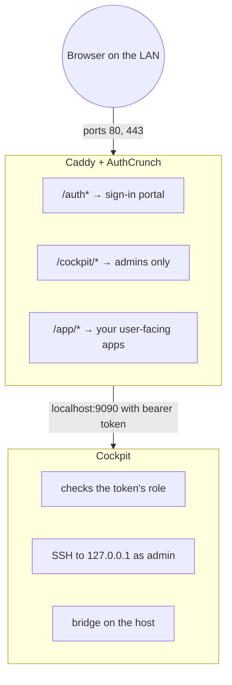

# OIDC Device Management

This tutorial gives a device a browser-based management console behind single sign-on. You provision the example
bundle in `example/caddy-oidc`, which runs two containers:

- **Caddy with AuthCrunch**, a reverse proxy that signs users in through Microsoft Entra ID (or another OIDC provider)
  and decides who may reach each route.
- **Cockpit**, a web console for the device's services, logs, files, and Podman containers. Only administrators can
  reach it.

Users sign in once, through your identity provider. The stack is meant for management from the local network: Caddy
issues its own certificate, so the device needs no public domain and no inbound internet access.

## How it works



1. You open `https://<GATEWAY_DOMAIN>/cockpit/`.
2. Without a valid session cookie, Caddy sends you to the `/auth/` portal, which signs you in with Entra ID.
3. AuthCrunch gives every user from your tenant the `authp/user` role. Members of the admin group you name also get
   `authp/admin`. It stores the roles in a signed JWT cookie.
4. Caddy lets a request into `/cockpit/*` only if the token carries `authp/admin`, and passes the token on to Cockpit
   as a bearer token.
5. Cockpit's bearer-token helper checks that the token is unexpired, signed with an accepted algorithm, and carries
   `authp/admin`, then starts the session as the local `admin` user. There is no second login. Caddy remains the
   boundary that verifies the token's signature.
6. Cockpit reaches the host over SSH to `127.0.0.1` as `admin`, using a key the container generates and adds to that
   user's authorized keys, and runs the Cockpit bridge on the host.

## Before you start

You need:

- a device you can provision, with a LAN client to browse from;
- an SSH key for the `admin` user; Cockpit always signs in as `admin`, so your configuration must declare that user;
- an identity provider application, set up as below.

### Set up Microsoft Entra ID

1. In the Azure portal, open **Microsoft Entra ID** > **App registrations** and select **New registration**.
2. Set the redirect URI to:

   ```text
   https://<GATEWAY_DOMAIN>/auth/oauth2/azure/authorization-code-callback
   ```

3. Note the **Application (client) ID** and the **Directory (tenant) ID**.
4. Under **Certificates & secrets**, create a client secret and copy its value.
5. Under **Token configuration** > **Add groups claim**, select **Security groups**.
6. Create a security group for device administrators and add the people who should reach Cockpit. Everyone else in
   the tenant can still sign in and gets only the user role.

### Or use Google

1. In Google Cloud Console, open **APIs & Services** > **Credentials** and create an **OAuth client ID** for a web
   application.
2. Add this authorized redirect URI:

   ```text
   https://<GATEWAY_DOMAIN>/auth/oauth2/google/authorization-code-callback
   ```

3. Note the client ID and client secret.
4. Decide how administrators are recognized, for example a Google Workspace group claim, a hosted-domain claim, or an
   explicit email allow-list in the AuthCrunch `transform user` rules.
5. In the Caddyfile, replace the `azure` identity provider block with a Google one, and change the `azure` realm in the
   portal and transform rules to `google`:

   ```caddyfile
   oauth identity provider google {
       realm google
       driver google
       client_id {env.GOOGLE_CLIENT_ID}
       client_secret {env.GOOGLE_CLIENT_SECRET}
       scopes openid email profile
   }
   ```

6. Replace the Azure environment variables in `config.toml` with your Google client ID and secret.

Driver options can vary between AuthCrunch versions; the values that matter are the provider and realm name, the client
ID and secret, and the callback path.

Any other AuthCrunch-supported OIDC provider works the same way: change the identity provider block, the callback URI,
and the role rules.

## What is in the bundle

```text
example/caddy-oidc/
  config.toml
  files/
    caddy/
      Caddyfile
      ui/                 sign-in page templates and images
    cockpit/
      Containerfile
      rootfs/             Cockpit startup, auth helper, and branding
```

- [`config.toml`](https://github.com/RobertDeRose/atomixos/blob/dev/example/caddy-oidc/config.toml) declares the
  `admin` user, opens WAN ports 80 and 443, builds the Cockpit image, and defines both containers. It lists both
  containers under `[activation].required`, so a change only succeeds if they come up healthy.
- [`files/caddy/Caddyfile`](https://github.com/RobertDeRose/atomixos/blob/dev/example/caddy-oidc/files/caddy/Caddyfile)
  defines the sign-in portal, the role rules, and the `admin-policy` and `user-policy` authorization policies.
- [`files/cockpit/Containerfile`](https://github.com/RobertDeRose/atomixos/blob/dev/example/caddy-oidc/files/cockpit/Containerfile)
  builds a Fedora-based Cockpit image with the bridge, Files, Podman, and System modules.

Points worth knowing before you change the example:

- Both containers are `privileged = true`: Caddy binds ports 80 and 443, and Cockpit mounts the host's D-Bus, systemd,
  journal, and Podman sockets and the host root at `/host`.
- The Cockpit container depends on its build service through `After` and `Requires`, and uses `Pull = "never"` so
  Podman does not look for the locally built `localhost/cockpit-ws:latest` image in a registry.
- The build uses `Network = "host"`, which avoids setting up Podman's build network on the device.
- `${FILES_DIR}` points at the bundle's `files/` directory on the device. The example mounts its payloads read-only.
- Caddy's certificates live in the `caddy-data` Podman volume. Configuration export does not include volumes; back them
  up with Podman tooling if you need to.
- `GATEWAY_DOMAIN` goes to both containers: Caddy serves that name, and Cockpit builds its allowed origins from it.
- The `management` network is declared for later use; both containers currently use host networking.
- `/` redirects to `/cockpit/`. To publish an application to every signed-in user, add a route that uses
  `authorize with user-policy`; the Caddyfile has a commented-out `/app/*` example.

## Provision the stack

1. Copy `example/caddy-oidc` somewhere you can edit it.
2. Replace the placeholders in `config.toml`:

   | Placeholder                | Value                                             |
   |----------------------------|---------------------------------------------------|
   | `<SSH_PUBLIC_KEY>`         | Your SSH public key for the `admin` user          |
   | `<AZURE_TENANT_ID>`        | Entra directory (tenant) ID                       |
   | `<AZURE_CLIENT_ID>`        | App registration client ID                        |
   | `<AZURE_CLIENT_SECRET>`    | App registration client secret                    |
   | `<JWT_SHARED_KEY>`         | Shared key that signs and verifies session tokens |
   | `<GATEWAY_DOMAIN>`         | Local DNS name for the device                     |
   | `<ENTRA_ADMIN_GROUP_NAME>` | Entra group whose members get the admin role      |

   Generate the JWT key with:

   ```bash
   openssl rand -base64 32
   ```

3. Make `<GATEWAY_DOMAIN>` resolve to the device's address from your workstation: add a record on your LAN DNS server,
   or a hosts-file entry such as:

   ```text
   172.20.30.1 gateway.example.com
   ```

4. Package the bundle:

   ```bash
   tar --zstd -cvf config.tar.zst -C path/to/caddy-oidc .
   ```

5. Apply `config.tar.zst` through the bootstrap console, or as a signed change on a device that is already provisioned.
   See [Provisioning](../provisioning.md).
6. Open `https://<GATEWAY_DOMAIN>/` and sign in. The first start takes a while because the device builds the Cockpit
   image.

Caddy serves HTTPS with `tls internal`, its own local certificate authority, so your browser will not trust the
certificate at first. Either trust Caddy's root CA (stored in the `caddy-data` volume) on your workstation, or accept
the browser warning while testing.

## Harden it for production

The example favors a quick start. Before relying on it:

- **Use public DNS and real certificates** if the console is reachable from outside a trusted local network. The
  example's internal TLS is for local management only.
- **Use asymmetric token keys** (RS256 or ES256) instead of the shared HMAC key. AuthCrunch supports RSA and ECDSA key
  pairs.
- **Rotate secrets** such as `JWT_SHARED_KEY` and the identity provider client secret on a schedule.
- **Keep secrets out of environment variables.** Podman secrets keep them out of the Quadlet files on disk.
- **Pin image versions** instead of `:latest`.
- **Mind what admin means.** Every member of the admin group gets a Cockpit session as the device's `admin` user, with
  that user's full privileges.
